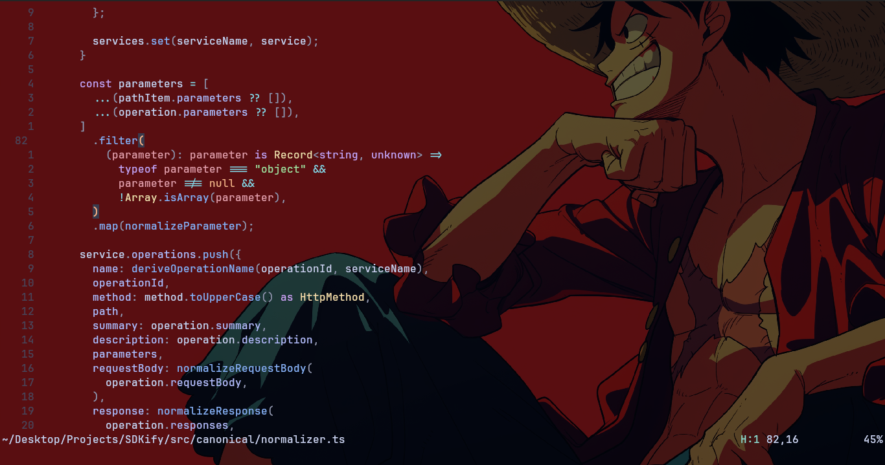
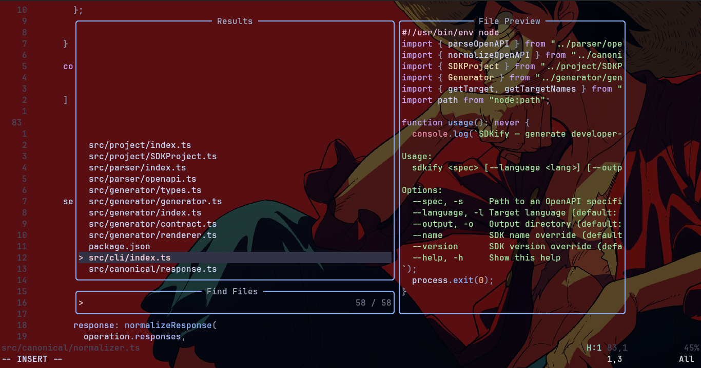
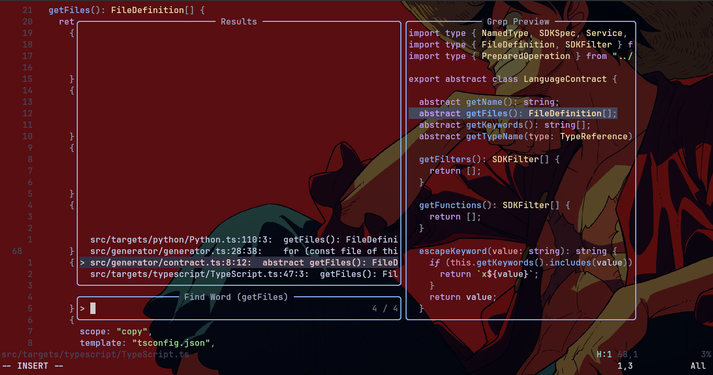

# My Neovim Setup

A drag and drop Neovim setup for JavaScript/TypeScript, Python, Lua and PHP work.

## Previews ;>





## What is included

- Lazy.nvim plugin management
- Catppuccin Mocha + transparent editor
- Telescope project/file search
- Harpoon quick file navigation
- Treesitter syntax parsing
- Native Neovim LSP: `vtsls`, `pyright`, `lua_ls`, `tailwindcss`
- PHP support through `php.nvim`
- `nvim-cmp` completion
- Conform formatting: Prettier, Stylua, Ruff
- Fugitive Git workflow
- Trouble diagnostics
- Undotree persistent undo
- LuaSnip snippets
- Zen Mode
- DAP debugging for JavaScript/TypeScript and Python
- DAP UI
- Supermaven
- VimBeGood learn vim with game

## Cheat sheet

If you are new to vim you can refer to [`CHEATSHEET.md`](./CHEATSHEET.md) for the mnemonic-first key reference.
For custom shotcuts we use special key called `<leader>` which is set to space bar and refered as `<space>` in cheatsheet.

## 1. System prerequisites

The config is intended for Linux. Install these **before** opening Neovim for the first time:

- Neovim 0.11+ (this setup was built on Neovim 0.12)
- Git
- `ripgrep` - Telescope live/project grep
- Tree-sitter CLI - parser installation/builds
- `wl-clipboard` on Wayland, or `xclip`/`xsel` on X11
- Donwload languages you're working with this setup support PHP JS/TS Python 3
- a Nerd Font for icons

### Ubuntu/Debian base packages

```bash
sudo apt update
sudo apt install -y ripgrep wl-clipboard
```
## 2. Tree-sitter CLI

This setup used Tree-sitter CLI `0.27.1`. On older Linux distributions, prebuilt/npm binaries can require a newer GLIBC.
Don't install it with npm. Building the CLI with Cargo is a reliable fallback:

```bash
cargo install tree-sitter-cli --version 0.27.1
mkdir -p ~/.local/bin
cp ~/.cargo/bin/tree-sitter ~/.local/bin/tree-sitter
```

Rust/Cargo is only needed for that build; it does not need to stay installed if you copy the resulting binary somewhere on your `PATH`.

## 3. Terminal + font

Kitty is recommended, but Neovim does not depend on it.

Install Kitty from its official installer/package for your system, then configure a Nerd Font such as **JetBrainsMono Nerd Font**. The Nerd Font is what makes plugin icons render correctly.

If using Wayland, keep `wl-clipboard` installed and use:

```lua
vim.opt.clipboard = "unnamedplus"
```

## 4. Install the config

Back up an existing config first:

```bash
mv ~/.config/nvim ~/.config/nvim.backup
```

Clone this repository:

```bash
git clone <YOUR-GITHUB-REPO-URL> ~/.config/nvim
nvim
```

Lazy.nvim will bootstrap itself and install plugins.

Then run:

```vim
:Lazy sync
```

## 5. Mason tooling

Open:

```vim
:Mason
```

Install/verify these tools:

### LSP

- `vtsls`
- `pyright`
- `lua-language-server`
- `tailwindcss-language-server`

### Formatters

- `prettier`
- `stylua`
- `ruff`

### Debug adapters

- `js-debug-adapter`
- `debugpy`

You can install them explicitly when needed:

```vim
:MasonInstall vtsls pyright lua-language-server tailwindcss-language-server prettier stylua ruff js-debug-adapter debugpy
```

## 6. Treesitter parsers

Install the languages you actually use. This setup has used:

`bash`, `c`, `cpp`, `css`, `gitignore`, `go`, `html`, `javascript`, `json`, `jsx`, `lua`, `markdown`, `markdown_inline`, `python`, `query`, `tsx`, `typescript`, `vim`, `vimdoc`.

Use the Treesitter commands/config from the repo to install missing parsers.

## 8. Health checks

Useful checks after a fresh install:

```vim
:checkhealth
:checkhealth vim.lsp
:Lazy
:Mason
```

To inspect LSP clients attached to the current buffer:

```vim
:lua =vim.lsp.get_clients({bufnr = 0})
```
